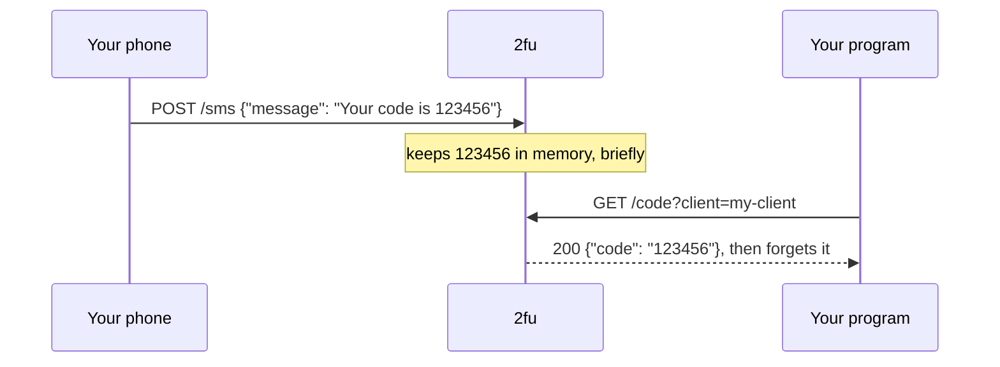

# 2fu

**Hand a 2FA text-message code to one known program, once.**

<!-- bricoleur:intro -->
> Part of **[bricoleur.ai](https://bricoleur.ai)**: small, honest tools cobbled together from the AI-era parts at hand.
<!-- /bricoleur:intro -->



## What it does

- Takes the text of a 2FA SMS that your phone forwards, and finds the code in it.
- Hands that code to the first allowlisted program that asks, then forgets it.
- Holds it in memory only briefly: five minutes by default. One Python file, standard library only, nothing
  written to disk.

## Quick start

```sh
git clone https://github.com/bricoleur-ai/2fu
cd 2fu
python3 server.py
```

It prints `listening on port 8787, clients: my-client, codes live 300s`. In a second terminal, play
the phone, then the program waiting for the code:

```sh
curl -i -X POST http://localhost:8787/sms \
  -H 'Content-Type: application/json' \
  -d '{"message": "Your verification code is 123456"}'
curl -i 'http://localhost:8787/code?client=my-client'
```

It worked if the second command answers `200` with `{"code": "123456"}`. Run it again and the
answer is `404`: the code was handed over once and is gone.

## How it works

2fu is one slot behind a lock. `POST /sms` finds the code in the message and stores it, replacing
any code nobody has fetched. `GET /code` checks the caller's name against the allowlist before
anything else. It then takes the code and clears the slot in one step, so two callers can never
both get it. The [technical brief](https://bricoleur.ai/projects/2fu/how-it-works) walks through
it, and the design notes are in [docs/DESIGN.md](docs/DESIGN.md).

## What it deliberately does not do

- **No authentication.** `POST /sms` accepts any message, so anyone on your network can post a
  bogus code, even replacing a real one that is waiting. `GET /code` asks only for a client
  *name*: it keeps out programs you didn't name, but a name is not a password, and anyone on the
  network who knows or guesses one can fetch the waiting code.
- **No TLS.** Keep it on a network you trust (LAN, VPN, Tailscale), never on the open internet.
- **No storage and no queue.** One code at a time, in memory; a restart drops it.
- **No access to your messages.** It sees only what your phone chooses to forward.

## Configuration

Settings come from the environment. Unset or blank means the default:

| Variable | Default | Meaning |
|---|---|---|
| `TWOFU_CLIENTS` | `my-client` | names allowed to fetch a code, comma-separated |
| `TWOFU_PORT` | `8787` | port to listen on, on all interfaces |
| `TWOFU_TTL_SECONDS` | `300` | how long an unfetched code lives |

```sh
TWOFU_CLIENTS=laptop,browser TWOFU_PORT=9000 python3 server.py
```

A value 2fu cannot use stops it at start, with a message naming the variable.

## Endpoints

| Request | Result |
|---|---|
| `POST /sms` with JSON `{"message": "<full SMS text>"}` | `204` code stored · `422` no code found · `400` bad body · `413` body over 16 KB |
| `GET /code?client=<name>` | `200 {"code": "123456"}` and the code is dropped · `403` unknown client · `404` nothing pending |

Programs poll `GET /code` until they get a `200`. The client name is checked first, so an unknown
caller cannot even tell whether a code is waiting. Names match exactly, including case.

## Code parsing

2fu takes the 4–8 digit number that follows a keyword (`code`, `PIN`, `passcode`, `password`,
`OTP`). Failing that, it takes the first standalone 4–8 digit number. `123-456` and `123 456` are
joined. A message with no such number gets `422`, and any code already waiting is left alone.

## Forward texts from an iPhone

1. Shortcuts app → **Automation** → **＋** → **Message**.
2. **Message Contains** a word your 2FA texts share, for example `code`. Choose **Run Immediately**.
3. Add **Get Contents of URL**.
4. URL: `http://<your-2fu-host>:8787/sms` (or your `TWOFU_PORT`).
5. Method `POST`, Request Body `JSON`, one field `message` set to the **Shortcut Input** (the
   incoming message).

Add one automation per keyword if your texts don't share one. Any other way of forwarding a text
that can POST JSON works as well.

## Run as a service (Linux, systemd user unit)

```sh
mkdir -p ~/.config/systemd/user
cp 2fu.service ~/.config/systemd/user/
mkdir -p ~/.config/2fu && cp 2fu.env.example ~/.config/2fu/env   # then edit it
# edit ExecStart in ~/.config/systemd/user/2fu.service to point at your checkout
systemctl --user daemon-reload
systemctl --user enable --now 2fu
loginctl enable-linger "$USER"   # so it runs without a login session
journalctl --user -u 2fu -n 5    # shows "listening on port …" once it is up
```

The log records events only: a code stored, a code served (and to which client), a fetch denied
(with the name offered), and a message with no code. It never contains a code or the message
text.

## Tests

```sh
python3 -m unittest
```

## The full guide

From phone to program, with the reasoning behind each limit:
**[bricoleur.ai/projects/2fu](https://bricoleur.ai/projects/2fu)**.

<!-- bricoleur:footer -->
---
Part of **[bricoleur.ai](https://bricoleur.ai)** · [Full guide](https://bricoleur.ai/projects/2fu) · MIT © 2026 DynamoFoundry LLC
<!-- /bricoleur:footer -->
